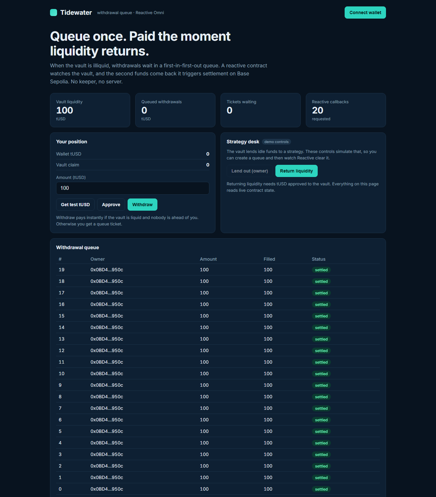
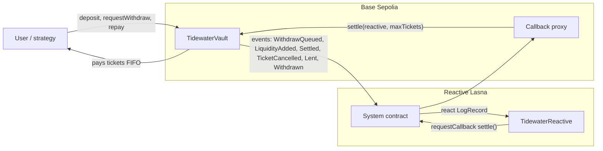
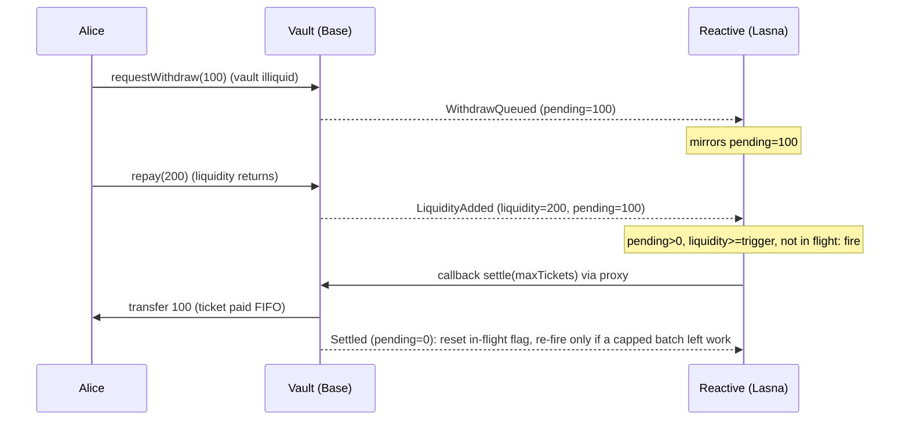
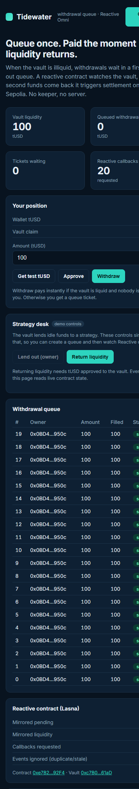

# Tidewater

**A cross-chain withdrawal queue that settles itself the moment liquidity returns.**
Built on [Reactive Omni](https://dev.reactive.network) for the Reactive Omni Buildathon 2026, Track: *Every Second Counts*.



**Demo video (2:47):** [https://youtu.be/Unu0CWuicEc](https://youtu.be/Unu0CWuicEc). Recorded from the live app against the v2 contracts during real testnet transactions. Narration uses a synthetic voice.

## The problem

Vaults that put deposits to work (lending, staking, market making) are often illiquid when users want out. Today the usual answers are all poor:

- users **refresh and retry** until funds reappear, and the first to retry wins, not the first in line;
- operators run a **keeper bot** that polls and settles, which needs a server, a funded hot key and 24/7 uptime;
- protocols **pause withdrawals** and settle by hand.

## The solution

Tidewater gives the vault a **first-in-first-out withdrawal queue**. If funds are not available, a withdrawal becomes a ticket. A **reactive contract on Reactive Omni** watches the vault's events and, the moment liquidity comes back, requests a callback on Base Sepolia that pays the queue in order. No keeper, no server, no one pressing "settle".

## Why Reactive

| Need | Plain contract | Keeper bot | Tidewater on Reactive |
|---|---|---|---|
| React to liquidity returning | cannot, contracts do not wake themselves | polls an RPC | native event subscription |
| Operator infrastructure | none, but nothing happens | server + hot key + uptime | none |
| Decides *whether* to act | n/a | off-chain code | on-chain logic that mirrors queue state from events, dedupes, ignores stale events, rate-limits, re-fires after a capped batch |
| Trust in the settler | n/a | the bot operator | a callback proxy plus an authorised reactive contract, enforced by the vault |

The reactive contract is not a relay. It keeps its own copy of the queue (pending amount, liquidity) built only from vault events, and fires a callback only when `pending > 0`, liquidity meets a threshold, and no settle is already in flight.

## Architecture





The queue is a **doubly linked list**: cancelling and settling are O(1) per ticket and `settle` only ever visits live tickets, so there is nothing to skip over (a griefing vector found in the v1 review, see [SECURITY.md](SECURITY.md)).

## Contracts (v2, current)

| Contract | Network | Address |
|---|---|---|
| `TidewaterReactive` | Reactive Lasna (5318007) | [`0xe7B2A395E352b3a9c7Af5DC249CbB46243b092F4`](https://lasna.reactscan.net/address/0xe7B2A395E352b3a9c7Af5DC249CbB46243b092F4) |
| `TidewaterVault` | Base Sepolia (84532) | [`0xc7B06Bf2e5c6Fbc7817631DB81842Ee3c6Df61aD`](https://base-sepolia.blockscout.com/address/0xc7B06Bf2e5c6Fbc7817631DB81842Ee3c6Df61aD) |
| `TideToken` (tUSD, test only, shared with v1) | Base Sepolia | [`0xde9cAF1626f5680c2d7961ca4fd1638D3c4a1885`](https://base-sepolia.blockscout.com/address/0xde9cAF1626f5680c2d7961ca4fd1638D3c4a1885) |

Callback proxy used: `0x476F44b11F5C942c58f4c8E3d0300E5710743585` (Base Sepolia). The token and the v1 Lasna contract share an address because each was the deployer's first transaction on its chain. Source verification on explorers has not been completed. The earlier v1 deployment is archived in [`deployments/v1`](deployments/v1) and is superseded: an independent review found a griefing bug in it that v2 fixes.

## Verified end-to-end transactions (v2)

20 full loops on the v2 contracts. Each is one user transaction on Base (origin event), then the reactive contract's reaction on Reactive Lasna, then the settlement callback on Base. Base hashes can be opened on [Blockscout](https://base-sepolia.blockscout.com); the Lasna hashes are the transactions in which `TidewaterReactive` emitted `SettleRequested` (the contract is on [ReactScan](https://lasna.reactscan.net/address/0xe7B2A395E352b3a9c7Af5DC249CbB46243b092F4)).

| # | Origin: `repay` on Base (LiquidityAdded) | Reaction on Lasna (SettleRequested) | Callback: `settle` on Base (Settled) | Base blocks | On-chain delta |
|---|---|---|---|---|---|
| 1 | `0x675fcc97701b9d93376b152fd1aafa4b342383a09fb64518aae66e3749c213c1` | `0x90d59edd1750433e6f0d3f760eb4c207f59ad678b22e3b23ce6ee25abf3c3e32` | `0x049837a44e5ea2e96952c0fef21d1d159adb681a9b613a5346a6cd950dc5adc1` | 9 | 1.8 s |
| 2 | `0x64870d3b9324a345ba5f965c16be010a84c94abd6e268f31bd1f4cc1dbbbe957` | `0xefa7bb1cbd930839567f6f4d2f01f722f017d9a33769a81c7eed589f573ed79b` | `0x4258ee36891a0f147576237d632aad0d42d46c8a588e3ace6700265726417ee3` | 7 | 1.4 s |
| 3 | `0xcba84fa0c8c8ec9b3b232c7b3f002c2c3ea68ce9b5b4c745eeb3c5cf90c9d2e1` | `0x5daba87705eb28e07561d82afc4450dc0d936c2f372efa4df6cc6ee7cf3404cc` | `0xe03adfe6a562bb131f5cf2f8612c4ccd9f099cb0353716c8d6d6fcad546dee5e` | 6 | 1.2 s |

<details><summary>All 20 loops</summary>

| # | Origin (Base) | Reaction (Lasna) | Callback (Base) | Base blocks | On-chain delta |
|---|---|---|---|---|---|
| 1 | `0x675fcc97701b9d93376b152fd1aafa4b342383a09fb64518aae66e3749c213c1` | `0x90d59edd1750433e6f0d3f760eb4c207f59ad678b22e3b23ce6ee25abf3c3e32` | `0x049837a44e5ea2e96952c0fef21d1d159adb681a9b613a5346a6cd950dc5adc1` | 9 | 1.8 s |
| 2 | `0x64870d3b9324a345ba5f965c16be010a84c94abd6e268f31bd1f4cc1dbbbe957` | `0xefa7bb1cbd930839567f6f4d2f01f722f017d9a33769a81c7eed589f573ed79b` | `0x4258ee36891a0f147576237d632aad0d42d46c8a588e3ace6700265726417ee3` | 7 | 1.4 s |
| 3 | `0xcba84fa0c8c8ec9b3b232c7b3f002c2c3ea68ce9b5b4c745eeb3c5cf90c9d2e1` | `0x5daba87705eb28e07561d82afc4450dc0d936c2f372efa4df6cc6ee7cf3404cc` | `0xe03adfe6a562bb131f5cf2f8612c4ccd9f099cb0353716c8d6d6fcad546dee5e` | 6 | 1.2 s |
| 4 | `0xc24d453db6d6229bb35a9f1066e7c5468955aeac6b9bd834f2bd198c1d406ded` | `0x549693f70d1f679dd8e5ffe26608fbf576da09edce376c12b3c07332c76f136b` | `0xcc7390b36620dade24ebd468322b709185926be0bb228f7edcb35b9ee2ad9a0e` | 7 | 1.4 s |
| 5 | `0xe36ddd966eafd4db042d9f2e019c78d6fd55dd723293a1d5e9e173c8bc964f9d` | `0xbf501a272dc7dac4a2706094128c285618789816787669cbfd9105f8ef1ee487` | `0xec8cc8ef326a33da655e04cd51e019f5b592605ffadb0df06ecfde0370543011` | 10 | 2.0 s |
| 6 | `0xaa7db84bb9cfdba0653791b1304a3e491e9f8c535401c9aaecf633b535e3853f` | `0x7875a2795e8f7a4eb5298a84eda704e4490b40c9af0ea41b5d54528d203bf6ef` | `0x45cf7a209f522f5fc2fd3e363f6cdda5ecbc8e40132860c247c3c5d12f1760d1` | 5 | 1.0 s |
| 7 | `0x0153e78bfa2e13f677ed070bab4b66dc0eecb67a45024b714188bc75b67a9519` | `0x8c0e0a3b35253f9087afaebc1125a097d2b980b6b0c3edd7769815016fcfc352` | `0xdce12964e0f2151cb749fd90f27a2c58850067f124f02edf1101a454f9761527` | 7 | 1.4 s |
| 8 | `0x36aa8aa38e1349cc220ecdab59c364ca5fe7f302e526b34ee15a93c99aac1846` | `0x517cabd634154e1287140799347d734dd55677d8ab249ae3733a189c4480aa48` | `0x418bd5ce503dfb156e0c02161ca05db823324e089fafa2f6cb6701703fc0cb27` | 9 | 1.8 s |
| 9 | `0xe2d6adf1d3621e579e8b068eaa8bb04ad8a4dcd4e16470052e4f9ab992e987dd` | `0x370181dbbea1cdabbf773f2bb4e66dea84df0c4bcce53b604d6131bb3d79d0f0` | `0x93d9b8af29ef6b920462d41680eaca014e17ddaa7117ffdac88a04679b50f6d2` | 7 | 1.4 s |
| 10 | `0x3f09655935ca05ded11975e5f7659f457e9bb5098b793e44900ca3347ab29e91` | `0x2077263ac75629a81bcf9ca022e1f5f05c09ad569a62b2bd031dad61212f4dd4` | `0x6c9a6c2b5c5cb9e6c61aae4a1f20cfdbf19f28c97ea3f785cfd3047d6277973d` | 6 | 1.2 s |
| 11 | `0xc967a363d4dcaef3e4103ed486adac233da4d76a5cd4803b2e9c99f82aedd027` | `0xdf63a47e9a05d91248eed9b1451bf8e5b4c7de60227fca775069d472f3fa3d9f` | `0x75ae104c58aed8a6b2d5e6b114f10d0c9d3f560724117dce0e499efa8a68d1ee` | 9 | 1.8 s |
| 12 | `0x0869b79fb68cb7efcc97352b5c07d6dba8fc229dc52bd84b0d1091680b45d911` | `0xaf03aa2a3137963d3e4c43dc4ce41c7ba855aba8ddd25b81bf4cb0d2abbc0269` | `0xdacfc06b31c86e5df86608b0710799379a3e80906b737acc6afa161fca70d70e` | 7 | 1.4 s |
| 13 | `0x9cefb4c781d39619ffb5d47521c305718ee604ec051c3fb6e8c7de23fea92a66` | `0xb9a5cc32501d810af55854eb8db863176e4bfb837a441dc7f531ae673af86307` | `0xd3866572c5572a5b01559c7e235574b8ac54b1f95885ab9886fdc4165522ed73` | 6 | 1.2 s |
| 14 | `0xf13ab2d34551ea28db6751b0fa2fd19d48f67d21e5afcf5ba90a4ef91adc1b27` | `0xd8933b93e02b73083dae61148c51ab89e30f9dfc58127da525d95a8c349a7e16` | `0x3f60cd26b84ad2fb0817f99906e52c4e8c13c77cff082f9f4929cdf919f22efc` | 8 | 1.6 s |
| 15 | `0xf4dff3f1a932bfff35722ae357f881146b8ebddb62cb167d14ab1ba69518398e` | `0xfef75e302a86a0adc39f8b7c703c8dbbfb7d3b92821fe6fbde07c28f02a17da7` | `0xc9adcdcd72089dd737cc69f3e16ae61b835eacf16b109e222e094174a50755c6` | 7 | 1.4 s |
| 16 | `0xd2475f9dc9307e1675ba4eb1a440e1394b4bed805dd3ad443f44a2546e5b7a03` | `0x6696e4cddcd59708fdf158c20e15c1379cd620198c1df44187a359d5e35ed949` | `0x75ba4b08e83592d348a60df74d11937dcf18986c14a3b181809ecb22f72092d2` | 7 | 1.4 s |
| 17 | `0x5c453da03360615d919a82b4637a73b9f335f23b2e255694631c637385711378` | `0x28fc5e528a101a5521fb59f38444c4c242c2b331836a9f98982d8b5c9933bb07` | `0x2479adbaf5c7ee218b2ccf81ed54ceac5ef397fb14594b7345f7021d3dac933d` | 5 | 1.0 s |
| 18 | `0xbc3c708080628d6fe63e366517102169526a9afc2019a9351201ed9363969b59` | `0x9f311b537ebe76a6465621488fe3ffe36a90aa843025b817adbd16bcf371d9cb` | `0x3fbdb949912589d8e21cc24f9bb20cfd5f4fa9d0802bb9a2ac3200fbeb14be86` | 7 | 1.4 s |
| 19 | `0xc3bfb12bfb155dea2aa4af2f8a0b246305f862a8db330ca6b4034d917b91245f` | `0x5f0c67fd01720ed2b0e35568ef8be30f94b450c00499778159a550759a2e94cc` | `0x817055497fb143598235b7b5c5f478948393657169b3b737c04852a1da503b17` | 5 | 1.0 s |
| 20 | `0x23ed55b4b484c72208839e896ca5a382f34af5e93b877456bed461f6b97a4fc3` | `0xce85c1751796d719a8166eadf5a5c370436d913c5662c27c110cfa7cdd0549c1` | `0x5a1146dea1b1bc43abe88fd82a868eba1f3aea94ea4969839f8500371dcf9ca1` | 10 | 2.0 s |

</details>

Raw records: [`deployments/measurements.jsonl`](deployments/measurements.jsonl) and [`deployments/lasna-links.json`](deployments/lasna-links.json).

## Measured latency (v2, 20 loops)

**On-chain, from block timestamps.** Base blocks carry millisecond timestamps, so the gap from the origin block to the settle block is measured with no client polling:

| Trials | Min | Median (p50) | p95 | Max | Base blocks |
|---|---|---|---|---|---|
| 20 | 1.0 s | 1.4 s | 2.0 s | 2.0 s | 5 to 10 |

**Client-polled** (a script polling the vault every ~0.25 s after the repay transaction confirms): min 1.06 s, median 1.65 s, max 2.43 s.

Caveats, stated plainly: one laptop over public RPCs, one scenario repeated 20 times, and no keeper baseline measured yet. The number covers the whole loop (Base event, Reactive, callback, Base settlement), not Reactive's block time alone. Lasna block timestamps are whole seconds only, so a per-hop split is not reported; it would be an artefact of rounding.

## Dashboard

| Desktop | Mobile |
|---|---|
|  |  |

The dashboard reads live chain state: vault liquidity, queued amount, the ticket table, the reactive contract's mirrored state and the measured loops.

## Quick start

Requirements: [Foundry](https://getfoundry.sh), Node 20+.

```bash
git clone --recurse-submodules https://github.com/Jean-Regis-M/tidewater.git && cd tidewater
forge test                      # 34 tests: unit, fuzz and stateful invariants
cp .env.example .env            # add a THROWAWAY testnet PRIVATE_KEY
bash scripts/deploy.sh          # needs Base Sepolia ETH and lREACT on Lasna
bash scripts/live_loop.sh 3     # run live queue to settle loops
cd frontend && npm install && npm run dev
```

Funding the deployer on testnets: Ethereum Sepolia ETH can be sent to the Reactive faucet contract (`request(address)`, 1 ETH = 100 lREACT) per the [Reactive docs](https://dev.reactive.network/reactive-mainnet).

## Repository layout

```
src/          TidewaterVault, TidewaterReactive, TideToken
test/         Foundry tests (mock system contract) and invariant tests
scripts/      deploy.sh, live_loop.sh
deployments/  testnet.json (v2), measurements.jsonl, lasna-links.json, v1/ (archived)
frontend/     React + Vite + viem dashboard
docs/         screenshots
```

## Security

- `settle` is callable only by the Base callback proxy and only for the authorised reactive contract (`onlyServiceProvider` + `onlyCallbackSender`), and visits at most `MAX_BATCH` live tickets per call.
- Funds are paid only to ticket owners, in queue order. Reentrancy guard on every state-changing function. Failed payouts (for example a blocklisted recipient) are parked for pull payment instead of stalling the queue.
- Minimum ticket size and a per-user open-ticket cap; `lend` and `setStrategy` are blocked while any withdrawal is queued; exits are never paused.
- The reactive contract dedupes events by `(chainId, txHash, logIndex)`, ignores out-of-order events, rate-limits callbacks by timestamp, re-fires after a capped batch, and has bounded policy settings.
- 34 Foundry tests, including the attack scenarios from an independent adversarial review and stateful invariants over 128,000 random calls. Slither 0.11.6: no High findings. Details, and the v1 findings that drove these changes, in [SECURITY.md](SECURITY.md).

## Known limitations

- Prototype on testnets. Not audited. The independent review used mock system and proxy contracts, not the real ones.
- The owner can still lend all idle liquidity (only while the queue is empty) and repoint the strategy (same condition); there is no timelock or multisig. On the deployed vault the owner and strategy are the same wallet.
- The vault is a mock: 1:1 claims with no yield, a demo strategy address and one test token with an open mint.
- The user-facing flow starts and ends on Base Sepolia; the cross-chain hop is Base to Reactive Lasna to Base. A second origin chain (Unichain Sepolia) is on the roadmap, and there is no polling-keeper baseline measurement yet.
- If a settle callback is lost entirely, the 3-second cooldown expires and the next liquidity event retriggers it; there is no heartbeat.
- Contract source is not yet verified on explorers.

## Roadmap

A Unichain Sepolia origin for cross-chain liquidity signals with a keeper baseline, a timelock or multisig for owner actions, ERC-4626 and ERC-7540 compatibility, and explorer source verification.

## Contributing and licence

Issues and PRs welcome. MIT licensed, see [LICENSE](LICENSE).
