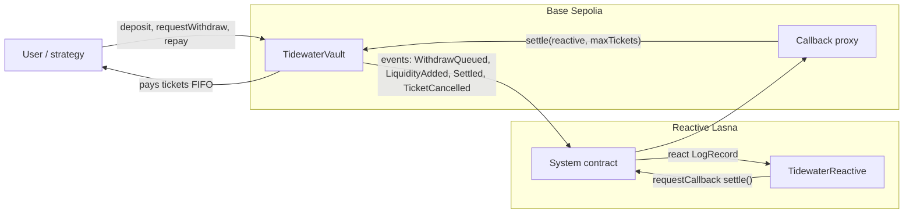
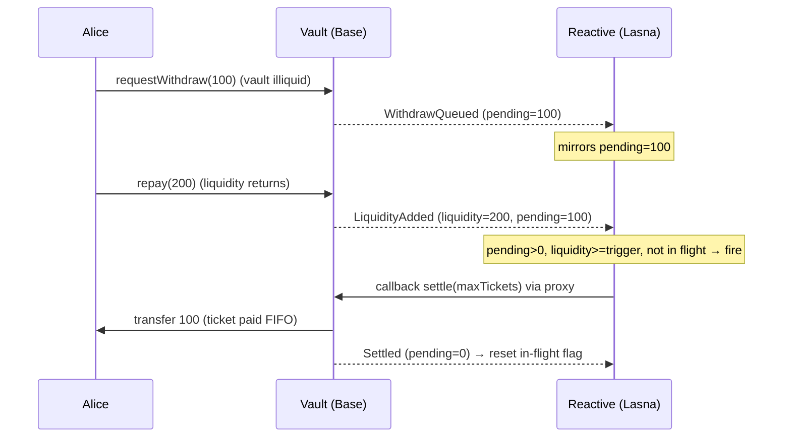

# Tidewater

**A cross-chain withdrawal queue that settles itself the moment liquidity returns.**
Built on [Reactive Omni](https://dev.reactive.network) for the Reactive Omni Buildathon 2026, Track: *Every Second Counts*.


**Demo video (2:34):** [https://youtu.be/d0XdrLkGFYM](https://youtu.be/d0XdrLkGFYM). Recorded from the live app during real testnet transactions. Narration uses a synthetic voice.

## The problem

Vaults that put deposits to work (lending, staking, market making) are often illiquid when users want out. Today the usual answers are all poor:

- users **refresh and retry** until funds reappear, and the first to retry wins, not the first in line;
- operators run a **keeper bot** that polls and settles, which needs a server, a funded hot key and 24/7 uptime;
- protocols **pause withdrawals** and settle by hand.

## The solution

Tidewater gives the vault a **first-in-first-out withdrawal queue**. If funds are not available, a withdrawal becomes a ticket. A **reactive contract on Reactive Omni** watches the vault's events and, the moment liquidity comes back, requests a callback on Base Sepolia that pays the queue in order. No keeper, no server, no one pressing "settle".

## Why Reactive

| Need | Plain contract | Keeper bot | Tidewater on Reactive |
|---|---|---|---|
| React to liquidity returning | cannot, contracts do not wake themselves | polls an RPC | native event subscription |
| Operator infrastructure | none, but nothing happens | server + hot key + uptime | none |
| Decides *whether* to act | n/a | off-chain code | on-chain logic that mirrors queue state from events, dedupes, ignores stale events, rate-limits |
| Trust in the settler | n/a | the bot operator | a callback proxy plus an authorised reactive contract, enforced by the vault |

The reactive contract is not a relay. It keeps its own copy of the queue (pending amount, liquidity) built only from vault events, and fires a callback only when `pending > 0`, liquidity meets a threshold, and no settle is already in flight.

## Architecture





## Contracts

| Contract | Network | Address |
|---|---|---|
| `TidewaterReactive` | Reactive Lasna (5318007) | [`0xde9cAF1626f5680c2d7961ca4fd1638D3c4a1885`](https://lasna.reactscan.net/address/0xde9cAF1626f5680c2d7961ca4fd1638D3c4a1885) |
| `TidewaterVault` | Base Sepolia (84532) | [`0x7cF8C75c98b8ffFA1707CDB35e739C846C6000dd`](https://sepolia.basescan.org/address/0x7cF8C75c98b8ffFA1707CDB35e739C846C6000dd) |
| `TideToken` (tUSD, test only) | Base Sepolia | [`0xde9cAF1626f5680c2d7961ca4fd1638D3c4a1885`](https://sepolia.basescan.org/address/0xde9cAF1626f5680c2d7961ca4fd1638D3c4a1885) |

The reactive contract and the token share an address because they were the deployer's first transaction on their respective chains. Callback proxy used: `0x476F44b11F5C942c58f4c8E3d0300E5710743585` (Base Sepolia). Source verification on explorers has not been completed.

## Verified end-to-end transactions

Each row is one full loop: a user transaction on Base (origin event) → Reactive reaction on Lasna → settlement callback on Base. All hashes are on Base Sepolia ([BaseScan](https://sepolia.basescan.org)).

| # | Origin: `repay` (LiquidityAdded) | Callback: `settle` (Settled) |
|---|---|---|
| 1 | `0x4b6fc5ac01c879d90ba6df732b3bcad6fe93a4db53e0feb48a2e9bf700ecacf9` | `0x613f4bb549802cc96bd1612b00211d9fb807589b6094cadb84d05cd45bd23a16` |
| 2 | `0x4413cd8ecea279f24822db4fb823ed2cd94e6a534fabeb053bfd2c306605107a` | `0x955545b21730715a72e30ab2e7857cb1f3b7fbd814c174405b2c17d2693e5dc4` |
| 3 | `0xcda87213b0b8f71d469ece7b2619f68eaf6ee2e80ae9576adf9dcdb150f42238` | `0xa80f72b050846d983de9aa94744290b7509f387f385643582e886b4189ebcfce` |
| 4 | `0xa8b9e0a3e548ea25c4efbd12232bf3115356bf959995efc34b772e71ab44dcc7` | `0xbdac86e4ca155b5430d635e65dc6e832e7bca192bc4b39b88369a951a5e63415` |
| 5 | `0x67b647bfed4d5e17de2e2d41854c66ac2cd091cfaf1275bd9b808be61420d516` | `0xac6976b34e65e998af072a08b983eb92c95da0d137b210b809905f1165a68481` |
| 6 | `0xfa68a013c06e03fb7c457d903aab9d57ddd63e5be87930d09f7ec9ee516b5ca2` | `0xbf68cc2a89f8e3e8f1dc435303ec23e4ba4886e64198b9a5a93cc7469fb58522` |

Raw records: [`deployments/measurements.jsonl`](deployments/measurements.jsonl).

## Measured latency

Time from the `repay` transaction being confirmed to the vault's `pending` dropping, measured by a script polling the vault every ~0.25 s:

| Trials | Min | Median | Max |
|---|---|---|---|
| 6 | 1.16 s | 2.38 s | 2.46 s |

Caveats, stated plainly: these are client-side measurements from one laptop over public RPCs, with about 0.5 s of polling and RPC resolution, so treat them as "about 1 to 2.5 seconds", not as precise protocol latency. The number is the whole loop (Base event → Reactive → callback → Base settlement), not Reactive's block time alone. Base block timestamps are whole seconds, so on-chain timestamp deltas are coarse.

Extra live scenarios run on testnet:

- **Unauthorised settle:** a direct call reverts with `NotAuthorized`; a proxy call with a spoofed reactive address reverts with `CallbackNotAuthorized`.
- **Burst:** three `repay` transactions sent within one block window produced two callbacks, not three (the in-flight cooldown suppressed the redundant one), and the queue still cleared fully.

## Screenshots

| Dashboard (desktop) | Dashboard (mobile) |
|---|---|
|  |  |

The dashboard reads live chain state: vault liquidity, queued amount, the ticket table, the reactive contract's mirrored state and the measured loops.

## Quick start

Requirements: [Foundry](https://getfoundry.sh), Node 20+.

```bash
git clone --recurse-submodules https://github.com/Jean-Regis-M/tidewater.git && cd tidewater
forge test                      # 22 tests incl. a fuzz test
cp .env.example .env            # add a THROWAWAY testnet PRIVATE_KEY
bash scripts/deploy.sh          # needs Base Sepolia ETH and lREACT on Lasna
bash scripts/live_loop.sh 3     # run live queue → settle loops
cd frontend && npm install && npm run dev
```

Funding the deployer on testnets: Ethereum Sepolia ETH can be sent to the Reactive faucet contract (`request(address)`, 1 ETH = 100 lREACT) per the [Reactive docs](https://dev.reactive.network/reactive-mainnet).

## Repository layout

```
src/        TidewaterVault, TidewaterReactive, TideToken
test/       Foundry tests (mock system contract)
scripts/    deploy.sh, live_loop.sh
deployments/  testnet.json, measurements.jsonl
frontend/   React + Vite + viem dashboard
docs/       screenshots
```

## Security

- `settle` is callable only by the Base callback proxy and only for the authorised reactive contract (`onlyServiceProvider` + `onlyCallbackSender`).
- Funds can only be paid to ticket owners, in queue order; reentrancy guard on state-changing functions; checks-effects-interactions in `settle`.
- The reactive contract dedupes events by `(chainId, txHash, logIndex)`, ignores out-of-order events and rate-limits callbacks by timestamp.
- Static analysis with Slither 0.11.6: no High findings (3 Medium, all analysed). Details in [SECURITY.md](SECURITY.md).

## Known limitations

- Prototype on testnets. Not audited.
- The asset is assumed to be a well-behaved ERC-20. A token that can block transfers to a ticket owner (a blocklist) would stall the head of the queue.
- If extra liquidity arrives inside the callback cooldown and no later event follows, it waits for the next liquidity event.
- Vault shares are 1:1 claims with no yield; the "strategy" is a demo address controlled by the owner.
- Contract source is not yet verified on explorers.

## Roadmap

Per-ticket recipients and skip-on-failure for blocklisting assets, re-fire when a settle leaves both pending and liquidity, a Unichain Sepolia origin for cross-chain liquidity signals, ERC-4626 / ERC-7540 compatibility.

## Contributing and licence

Issues and PRs welcome. MIT licensed, see [LICENSE](LICENSE).
